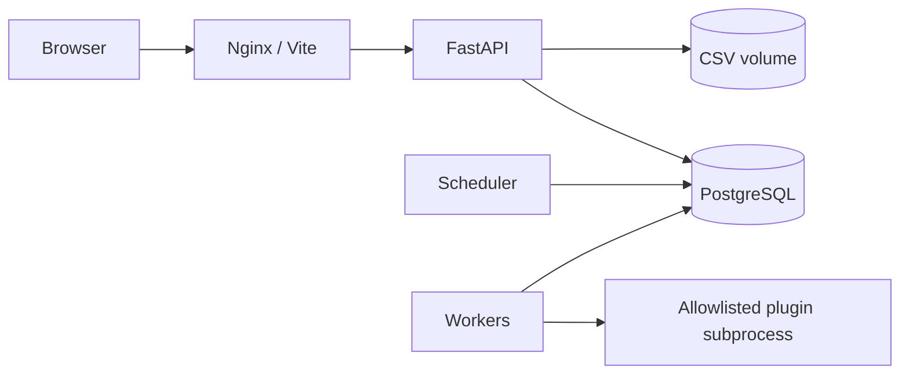

# Architecture

The API exposes project-scoped jobs, datasets, funding, audit and workflow operations. A project belongs to an organization. PostgreSQL stores project membership and operational state. The scheduler and workers publish through PostgreSQL transactions. Independent worker processes use the same image and accept work concurrently.
