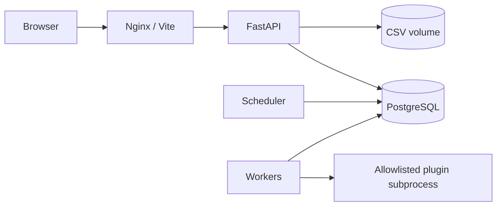

# Architecture

The API exposes project-scoped jobs, datasets, funding, members, audit and workflow operations. Platform admins create projects/accounts; project PIs manage ordinary members and audited role changes. PostgreSQL stores project membership, operational state and shared fixed-window API limits. `/metrics` is administrator-only and combines persisted queue/execution event distributions with bounded process-local HTTP request samples. The scheduler and workers publish through PostgreSQL transactions. Independent worker processes use the same image and accept work concurrently.
