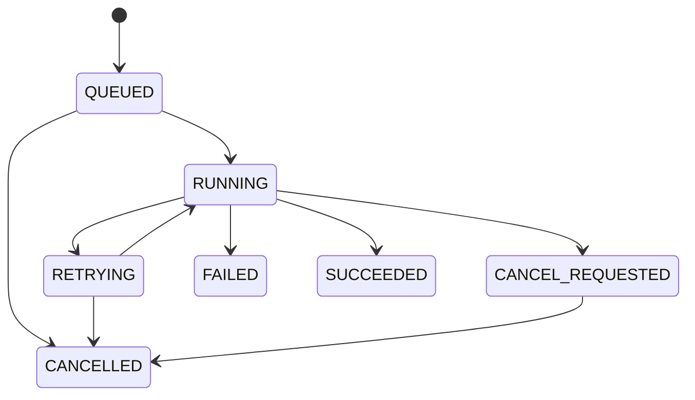

# Job execution

A project-scoped idempotency key identifies a submission and binds its inputs. Workers claim available rows with `FOR UPDATE SKIP LOCKED`. A claim creates a new token and finite attempt deadline. Heartbeats renew the lease up to that deadline. Completion checks the token and lease under the job row lock. Recovery schedules a bounded exponential retry or records a dead-letter event. Cancellation and completion serialize on the same locked row.
