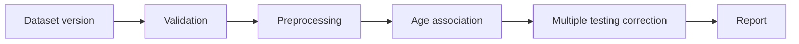

# Research plugin interface

Workers execute fixed, versioned plugin IDs registered in `backend/researchhub/plugins.py`. Each consumes JSON and returns JSON. Plugins run in subprocesses with finite attempt deadlines. Users can select the allowlisted summary or association plugin, or run a registered research pipeline with an authorized dataset version.

Upload [synthetic ages and expression](examples/genomics-synthetic.csv) and select Genomics in Workflows. The pipeline reuses the existing Spearman and Benjamini-Hochberg functions. Each stage consumes the preceding successful output, records its digest and inherits dataset provenance. The exploratory analysis omits covariate adjustment. The [wearable mobility pipeline](mobility-workflow.md) uses the same platform interfaces.
