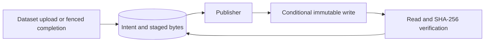

# PostgreSQL and object storage consistency



The source transaction stores its version or job result, the artifact intent and bounded staged bytes. A separate publisher commits AVAILABLE only after conditionally writing and verifying the object. The publisher locks a single pending record while performing bounded I/O. Database and object storage have separate commit points.

| Fault | Outcome |
| --- | --- |
| Database rejects the source transaction | No publisher can see the intent, so no object is written. |
| Object write succeeds and the publication transaction rolls back | Pending bytes and intent remain. A retry reads and verifies the existing object without replacing it. |
| Object write fails or a publisher exits | A later publisher retries. Temporary failures use bounded backoff. Local files publish with a same-filesystem atomic link. |
| A worker loses its lease | Fencing denies result completion and its artifact intent. A committed intent survives independently of the worker process. |
| A key already contains different bytes | The artifact is marked FAILED and the object is preserved for investigation. |
| An AVAILABLE object is missing or corrupt | Authorized downloads fail with 503. Restore the original immutable bytes from backup to recover them. |

Quota admission serializes by project and charges staged, available and failed managed artifacts plus legacy dataset sizes. Job results stay inline in PostgreSQL for workflow dependency evaluation. The API exports verified managed bytes. Orphan cleanup is explicit and removes only old canonical keys absent from the committed artifact registry. Use a bucket or managed prefix dedicated to a single database, including during cleanup.

```sh
docker compose exec scheduler python -m researchhub.artifacts cleanup-orphans
```

Run the same command with the S3 Compose file and profile when using that backend. An Alembic downgrade through 0009 removes artifact references and staged payloads. Back up the database and retain the matching object namespace before a downgrade.

Reproduce the process termination test with an installed VersityGW binary and a dedicated PostgreSQL test URL. From the repository root:

```sh
PYTHONPATH=backend python scripts/verify_s3_restart.py /path/to/versitygw
```

Set `RESEARCHHUB_TEST_DATABASE` first. The harness uses its own disposable PostgreSQL schema, loopback port and temporary object directory.
